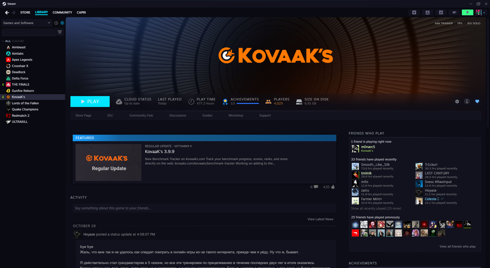

# Steam Digital Parasite Theme

A **Millennium** theme for the Steam client, inspired by **Capri** from *Cyberpunk: Edgerunners*. Neon rose & green on a deep dark background — a cyberpunk aesthetic for your Steam library.



## Palette

| Role | Color |
|------|-------|
| Background | `#0a0a12` |
| Secondary | `#12121f` |
| Rose (accent) | `#ff2d7a` |
| Green (accent) | `#39ff88` |
| Cyan (links) | `#00e5ff` |
| Yellow (warnings) | `#ffd93d` |
| Text | `#e8e6f0` |
| Muted | `#6b6880` |

## Based on

This theme is built on top of **[Simple Dark.](https://github.com/shdwmtr/simply-dark)** by ShadowMonster, reworked with the Digital Parasite color palette. Simple Dark provides a solid, well-tested CSS structure for the Steam client; Digital Parasite swaps in the Capri-inspired neon colors.

## Installation

1. Install **[Millennium](https://steambrew.app/)** (the Steam modding framework).
2. Close Steam completely.
3. Copy the `DigitalParasite` folder into your Steam installation:
   ```
   Steam/millennium/themes/DigitalParasite/
   ```
4. Restart Steam.
5. Go to **Steam → Millennium → Themes** and select **Digital Parasite**.
6. Reload Steam when prompted.

### Alternative (via Theme ID)

Once the theme is published on [steambrew.app](https://steambrew.app/themes), you can install it directly from Millennium:
- **Steam → Millennium → Themes → Install a theme** → paste the Theme ID.

## Features

- Dark cyberpunk background (`#0a0a12`)
- Rose (`#ff2d7a`) and green (`#39ff88`) neon accents
- Cyan links (`#00e5ff`)
- Custom scrollbars, buttons, inputs, tooltips, progress bars
- Styled Steam store (WebKit) with matching colors
- Fully functional library, friends, chat, settings, downloads, overlay

## Customization

The theme inherits Simple Dark's customization options (compacted header, wallet visibility, URL bar, etc.). Access them via **Steam → Millennium → Themes → Digital Parasite → Settings**.

## Credits

- **[Simple Dark.](https://github.com/shdwmtr/simply-dark)** by ShadowMonster — base CSS structure
- **Digital Parasite** concept by Sakyuu — color palette inspired by Capri (Cyberpunk: Edgerunners)
- **[Millennium](https://github.com/SteamClientHomebrew/Millennium)** — the modding framework

## License

MIT
